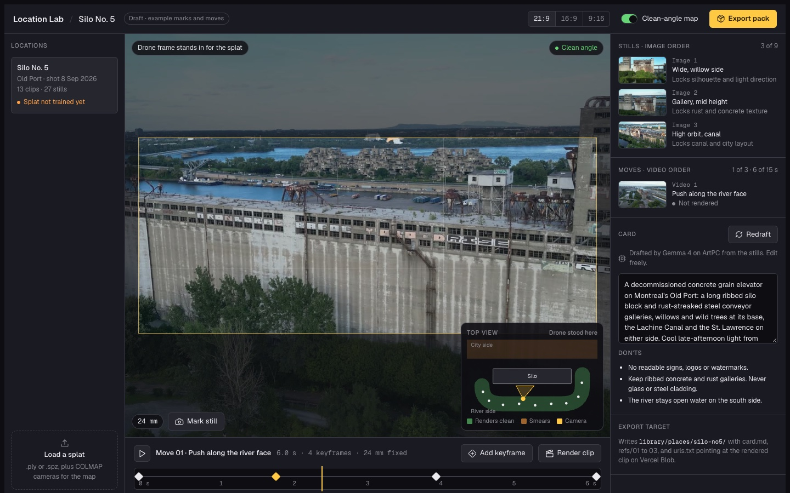

# Location Lab

**Problem.** A Gaussian splat of a real place is sharp from some angles and soft from others, and you find out which only after you render.

**Idea.** Scout the place in the browser first. Fly a camera through the splat, mark stills and record camera moves with a clean-angle map showing where the capture is sharp, then export a reference pack (card, ordered stills, camera-move clips) for Seedance 2.0's reference-to-video mode.

**Built.** A static HTML draft of the scouting screen (one file, no build step) and one parked experiment that turned a Seedance orbit clip into a splat and a mesh. There is no app code yet. 11 commits on 3 days, Oct 22 to Oct 30, 2026.

**Decision.** The splat comes from real drone and 360 footage, and the Seedance orbit-to-splat route is parked. Its Oct 30 test gave a backdrop and a lumpy blockout, because Seedance changes detail between frames and the splat averages that into blur.

Scout a real place in the browser, then hand it to Seedance 2.0.



*Screenshot of the draft scouting screen (static HTML, 1440 x 900). A drone frame stands in for the splat render, and the marks and moves are examples.*

Location Lab loads a Gaussian splat of a captured location, lets you fly a camera through it,
mark stills and record camera moves, and exports a reference pack for Seedance's
reference-to-video mode. A clean-angle map shows where the capture is sharp, so you pick
angles that render well before you render them.

## Status

Design phase. The first screen draft is in
[`drafts/2026-10-21-scouting-screen/`](drafts/2026-10-21-scouting-screen/index.html).
It uses a drone frame of Silo No. 5 in Montreal's Old Port as a stand-in for the splat.
There is no app code yet.

To look at the draft, open `drafts/2026-10-21-scouting-screen/index.html` in a browser straight from disk.
It is one HTML file plus the images in `img/`, with no build step. It loads Geist from Google Fonts and Lucide
icons from unpkg, so it needs a network connection to look right.

The screen has a locations list, the viewport with a clean-angle map, ordered stills and moves, an editable
location card with don'ts, a keyframe timeline for camera moves, and the export target.

## How it fits

```
drone + 360 footage ─► Postshot (splat + COLMAP cameras) ─► Location Lab ─► places pack ─► Seedance
```

The export is a folder: `card.md` with the canonical description, ordered reference stills,
and links to rendered camera-move clips.

<!-- BEGIN:generation-family -->
## Related repos

These seventeen repos make Nick's films together, from story to sound. Each handles one stage, and the same table sits in every one of them.

| Stage | Repo | What it does |
|---|---|---|
| Story and worlds | My Films (private) | The film worlds: bibles, scenes, production plans and generated-image archives |
| Story and worlds | Storytelling Kit (private) | Storytelling cards with artwork editions |
| Story and worlds | Film Writer (private) | World-first film development with the screenplay grown from it |
| Craft and reference | film-craft (private) | Craft rules, measured film norms and dated tool tests |
| Craft and reference | Film Analyzer (private) | Frame-by-frame close reading of films |
| Craft and reference | [Look Tokens](https://github.com/weeeha/Look-Tokens) | A film's look as one token table that composes shot prompts |
| Images | [Film Design System](https://github.com/weeeha/Film-Design-System) | Keeps characters, props and settings consistent across image generations |
| Images | [Idea to Prop](https://github.com/weeeha/idea-to-prop) | Keeps one prop design connected from concept image to fabrication |
| 3D, previs and props | 3D Models (private) | Generates 3D models from text, with a viewer and gallery |
| 3D, previs and props | [Scene Builder 3D](https://github.com/weeeha/scene-builder-3d) | Blocks out shots in 3D before anything is generated |
| 3D, previs and props | [film-previz](https://github.com/weeeha/film-previz) | Walk a generated set and save camera shots (spec stage) |
| 3D, previs and props | [Location Lab](https://github.com/weeeha/location-lab) | Scout a real place and hand it to Seedance (design stage) |
| 3D, previs and props | film-props (private) | 3D-printed props and pre-vis sets |
| Video | [Video Generation Pipeline](https://github.com/weeeha/Video-Generation-Pipeline) | Seedance and Runway video generation with reusable reference packs |
| Video | Local Video Pipeline (private) | Wan 2.2 and MiniMax H3 video drafts on a local GPU |
| Video | Continuity Lab (private, in progress) | Finds and repairs inconsistencies between generated video shots |
| Sound | [Audio Generation Pipeline](https://github.com/weeeha/Audio-Generation-Pipeline) | Local speech, voice cloning and sound effects |
<!-- END:generation-family -->
